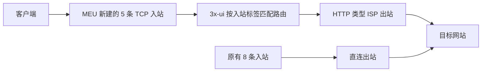

# 第 23 课：给 MEU 单独增加静态 ISP 出口

这次在新 MEU 上增加了一个名为 **ISP 出口（TCP）** 的订阅组。原有的“全线路”和“每月 100GB”订阅仍连接原来的直连入站；新组只包含 5 条独立入站，流量先到 MEU，再从购买的 HTTP 代理离开。三种格式的真实订阅地址和代理凭据保存在仓库外的 `account.md`。

## 为什么要新建入站和客户端

3x-ui 的“客户端分组”负责整理账号，不能单独决定流量从哪里出网。真正决定出站的是 Xray 的**路由规则**。规则可以看入站标签（`inboundTag`），所以我们复制了 5 条原有 TCP 入站，给新副本各自独立的标签，再让这些标签匹配 ISP 出站。原入站不改，原用户的流量不会突然切换出口。

“入站”是 MEU 接受连接的入口；“出站”是 MEU 转发连接时使用的出口。“订阅”是告诉客户端有哪些入口及认证信息的地址。一个人导入订阅以后，选择的节点决定走哪条入站，路由规则再决定从哪个出站离开。详见 [[10-MEU五个入站逐表单配置]] 和 [[11-将ISP代理接入tyccc链式出口]]。

## 面板里设置了什么

| 新节点 | 从哪个原节点复制 | 新端口 | 传输与安全 | 适合的用途 |
|---|---|---:|---|---|
| VLESS Reality | 原 2443 | 443/TCP | RAW + REALITY | 需要 Reality 的网页连接 |
| Shadowsocks | 原 18388 | 8388/TCP | Shadowsocks，只开放 TCP | 通用网页备用 |
| VLESS WS TLS | 原 18443 | 8443/TCP | WebSocket + TLS | 网页兼容 |
| VMess WS TLS | 原 18080 | 8080/TCP | WebSocket + TLS | 旧客户端兼容 |
| Trojan TLS | 原 19443 | 9443/TCP | TCP + TLS | 旧客户端兼容 |

每条新入站在**基础配置**里启用、填写上表端口、选择“自定义分享地址”并保持为 MEU 的公网地址；**协议、传输、安全**沿用对应原节点的设置，包括现有的证书或 REALITY 密钥。复制时清空原入站中的客户端列表，避免原订阅用户误入新线路。随后只把 `meu-isp-personal` 这个新客户端绑定到 5 条副本。

Shadowsocks 副本的网络从 `tcp,udp` 改为 `tcp`。本次购买的代理经验证是 **HTTP CONNECT 代理**，Xray 的 HTTP 出站仅承载 TCP；把 UDP 入站也放进组里，会让 Hysteria2、TUIC 等节点显示在订阅中却无法正确走该出口。因此新组不包含这两个 UDP 协议，也暂未纳入实验性质的 XHTTP。

在 **Xray 设置 → 出站**增加一项：协议选 `http`，填写代理的地址、端口、用户名和密码，标签设为 `meu-static-isp-http-20261105`。在 **路由**增加规则：`inboundTag` 填 5 条新入站的标签，`network` 填 `tcp`，`outboundTag` 指向上述标签。规则保存后检查是否持久化。账号与密码是服务端秘密，只保存在 MEU 配置和本地 `account.md`，不放进公开教程。

在 **客户端 → 分组**新建 `ISP 出口（TCP）`，创建独立客户端 `meu-isp-personal`，只绑定这 5 条入站并归入此组。当前客户端总流量设为 `0`，表示面板不设限额，流量重置为“从不”；它不继承现有“每月 100GB”客户端的额度。如需限额，应在此客户端上单独设置。新开端口已在 MEU 的 UFW 中允许 TCP；原有端口和防火墙规则保留。

## 订阅格式怎么选

从本地私有的 `account.md` 中“新 MEU 静态 ISP 出口”小节复制完整地址，不要把示例文字当链接。

| 客户端 | 使用的地址 | 实际节点数 |
|---|---|---:|
| v2rayN、v2rayNG、Shadowrocket 等支持原始分享链接订阅的客户端 | 原始订阅 | 5 |
| Clash Verge Rev、Mihomo 内核客户端 | Mihomo 订阅 | 5 |
| 旧版 Clash for Windows | 旧版 Clash 订阅 | 2 |

旧版 Clash 只收到 VMess、Trojan，是格式兼容筛选，不代表另外三条节点故障。导入时请使用客户端的“新增订阅／远程配置”入口，然后刷新订阅；**整条 HTTPS 订阅地址不是单个节点分享链接**。格式差异见 [[22-让v2rayN-Mihomo与旧版Clash分别订阅]]。

## 如何确认 ISP 确实生效

1. 在新订阅中选择任一 ISP 节点，启用客户端代理。
2. 通过该代理访问 `https://api.ipify.org`，看到的公网出口应为 `86.104.160.158`。这项检查要让查询请求**经过代理**，直接用浏览器访问并不一定能验证当前选中的节点。
3. 改选原有 MEU 直连节点再查，出口应回到 MEU 自身的公网地址。由此可区分两组线路。

本次从 MEU 服务器实测这组凭据可用作 HTTP 代理，并返回预期 ISP 地址；当作 SOCKS5 连接则超时。公网原始订阅返回 5 条节点，Mihomo YAML 返回 5 条，旧版 Clash YAML 返回 2 条。本机实测 Shadowsocks、VLESS WS TLS、VMess WS TLS、Trojan TLS 的出口均为 ISP 地址。VLESS Reality 也用 MEU 服务器上的新版本 Xray 验证成功；本地旧版 Xray 低于该入站设置的最低客户端版本，不能用它的握手失败判断服务器故障。

> [!NOTE]
> ISP 出口只改变目标网站看到的**出口 IP**。订阅中的节点仍连向 MEU 公网 IP；它不隐藏 VPS 的入站地址。订阅 URL 包含客户端的私有标识，拿到地址的人可使用对应额度，请按账号凭据保管。

## 参考

- [Xray 官方 HTTP 出站配置](https://xtls.github.io/en/config/outbounds/http.html)：HTTP 代理字段和仅支持 TCP 的限制。
- [3x-ui 官方出站与路由说明](https://github.com/MHSanaei/3x-ui/blob/main/docs/content/docs/en/operations/outbounds-routing.mdx)：出站标签、按入站匹配和规则顺序。
- [3x-ui 官方订阅说明](https://github.com/MHSanaei/3x-ui/blob/v3.8.5/docs/content/docs/en/config/subscription.mdx)：订阅与不同格式的输出。
