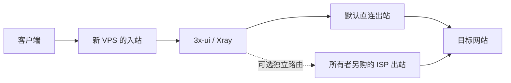

# AI 执行规范：从空白 VPS 到多协议订阅

把**这一个文件**交给协助搭建的 AI 即可。文中的域名、IP、账号和路径都是占位符，必须使用 VPS 所有者自己的信息替换。本文不包含任何现有服务器的真实凭据、订阅链接或证书。

## 0. 给执行 AI 的任务

你要在 VPS 所有者**自己控制的全新服务器**上搭建 3x-ui，建立下表中的代理入站、一个独立客户端和可更新的订阅；最后用真实网络请求验证每一条节点。按顺序执行，不要把“面板保存成功”当成连通性证明。软件版本和界面可能变化：开始前先读本文件末尾的官方文档，核对安装命令与当前面板字段；若字段不同，以当前官方文档和实际界面为准，并在交付报告中写清差异。

**作用范围**：只操作所有者提供的新 VPS、DNS 区域和新建客户端。不得读取、复制或复用别人已有 VPS 的数据库、UUID、密码、REALITY 私钥、订阅 Sub ID 或证书。若目标机器已有业务，先盘点监听端口、服务和备份，不能按“空白 VPS”流程覆盖。不要把密钥写进 Git、聊天记录、截图或本文件。

### 所有者需要提供的输入

让所有者在私密渠道提供下面的数据。不要要求所有者把密码填进公开 Markdown：

| 变量 | 含义 | 例子，必须替换 |
|---|---|---|
| `VPS_IP` | 新 VPS 的公网 IPv4 | `198.51.100.10`，文档示例地址 |
| `SSH_PORT`、`SSH_USER` | 服务商给出的 SSH 入口 | `22`、`root` |
| `SSH_AUTH` | SSH 私钥或初始密码的安全取得方式 | 所有者自己的密钥文件 |
| `NODE_DOMAIN` | 所有者控制的节点域名 | `node.example.com` |
| `DNS_ACCESS` | 能修改该域名 DNS 的权限或让所有者代操作 | 只需建 A 记录 |
| `ACME_EMAIL` | 证书续期通知邮箱 | `owner@example.com` |
| `CLIENT_NAME` | 新建客户端的内部标识 | `owner-main` |
| `OPTIONAL_ISP` | 是否另有 HTTP/SOCKS5 代理作为出口 | 默认无 |

`198.51.100.10` 是示例专用地址，`example.com` 是示例域名。AI 不得把它们直接部署进实际配置。若没有域名，可先完成不需要普通证书的 VLESS + REALITY 基线；TLS、Hysteria2、TUIC 和 HTTPS 订阅等到域名与证书就绪后再配置。

### 交付物与完成标准

交付给所有者：面板访问方式、节点域名、各协议端口、原始订阅地址、Mihomo 订阅地址、客户端兼容说明、证书续期状态、逐节点真实出口测试结果、备份位置。**密码、私钥和完整订阅令牌仅交给所有者的私密凭据文件**。失败项必须标明“未完成”，不能写成“已搭建”。

## 1. 目标架构与端口

第一轮只需要 VLESS + REALITY 一条可用入口。其余协议按表逐条添加，每加一条就立即验证。

| 顺序 | 备注建议 | 协议 / 传输 / 安全 | 端口 | 证书 | 地位 |
|---:|---|---|---|---|---|
| 1 | 日常主用 | VLESS / RAW(TCP) / REALITY | TCP 443 | 不需要普通 TLS 证书 | 必做 |
| 2 | 网页兼容 | VLESS / WebSocket / TLS | TCP 8443 | 需要 | 必做 |
| 3 | 通用备用 | Shadowsocks / TCP+UDP / 协议内加密 | TCP+UDP 8388 | 不需要 | 必做 |
| 4 | 老客户端备用 | VMess / WebSocket / TLS | TCP 8080 | 需要 | 可选 |
| 5 | TLS 备用 | Trojan / RAW(TCP) / TLS | TCP 9443 | 需要 | 可选 |
| 6 | UDP 网络测试 | Hysteria2 / QUIC / TLS | UDP 443 | 需要 | 可选 |
| 7 | 传输实验 | VLESS / XHTTP / REALITY | TCP 2444 | 不需要普通 TLS 证书 | 实验 |
| 8 | QUIC 对照实验 | TUIC v5 / QUIC / TLS | UDP 4443 | 需要 | 实验 |

这些是**建议端口**，不是协议强制端口。AI 应先运行 `ss -lntup` 查占用，再确定端口，并同步修改防火墙和交付表。TCP 443 与 UDP 443 可以同时使用，因为它们是不同的端口空间。只建立实际会用的节点；节点数量本身不会增加速度。



**名词约定**：协议决定如何识别和处理代理请求；传输决定连接如何承载；安全层负责 TLS 或 REALITY；入站是 VPS 接收连接的位置，出站是 VPS 访问目标网站的方式。WebSocket、RAW、XHTTP 是传输方式，不是另一个用户账号。

## 2. VPS、SSH、DNS 的前置检查

1. 选服务商提供的 **Debian 12 x86_64**（或当前受支持的 Debian 稳定版）最小系统。确认这是真正安装完成的系统，不是只挂载 ISO。保留服务商控制台或快照作为恢复路径。
2. 从服务商面板核对公网 IP、SSH 端口和初始登录方式。首次 SSH 连接核对主机指纹，不使用 `StrictHostKeyChecking=no` 消除指纹警告。
3. 登录后记录 `cat /etc/os-release`、`uname -m`、`systemctl is-active ssh`、`ss -lntup`。确认连接的是**新机器**，再继续。
4. 在 DNS 建 `NODE_DOMAIN → VPS_IP` 的 A 记录。如果用 Cloudflare，作为直接连接代理节点的记录选 **DNS only / 仅 DNS**；不要以为给面板开 Tunnel 就能隐藏直接连接节点的 VPS IP。等待 `dig +short NODE_DOMAIN A` 返回目标地址。若有 AAAA 记录，也要确认 IPv6 实际可用，否则删除错误的 AAAA。
5. 在服务商网络防火墙和系统防火墙中放行实际使用的端口。启用 UFW 前，**先允许当前 SSH 端口**；新开一个 SSH 会话验证能重连，才结束旧会话。推荐默认拒绝其他入站，仅允许 SSH、证书验证的 TCP 80、订阅端口 TCP 2096，以及上表实际创建的代理端口。

Debian 基础命令可按实际 SSH 端口调整：

```bash
apt update && apt upgrade -y
apt install -y curl ca-certificates ufw certbot dnsutils
ufw default deny incoming
ufw default allow outgoing
ufw allow <SSH_PORT>/tcp
ufw allow 80/tcp
ufw enable
ufw status numbered
```

先允许 SSH 再 `ufw enable`。AI 不能盲目把 `<SSH_PORT>` 当作字面字符串执行；要用所有者真实端口替换。如果服务商另有云防火墙，两处都要核对。

## 3. 安装与保护 3x-ui

1. 从 [3x-ui 官方安装文档](https://docs.sanaei.dev/zh/docs/guide/installation/)核对最新稳定版安装方式。在新 VPS 上以 root 运行官方脚本：

   ```bash
   bash <(curl -Ls https://raw.githubusercontent.com/mhsanaei/3x-ui/master/install.sh)
   ```

2. 安装器会生成随机管理员账号、密码和访问路径；面板端口以安装结果为准。将这些信息保存到所有者自己的私密凭据文件，权限设为 `0600`；不要写进公开教程。
3. 检查 `systemctl is-active x-ui`、`x-ui settings`、`ss -lntup`。通过 `x-ui` 管理菜单的 **SSH Port Forwarding Management** 或“面板设置”把管理面板监听地址设为 `127.0.0.1`，保留随机访问路径。面板端口不要开放到公网。
4. 在本机终端建立 SSH 端口转发，使用安装器显示的实际面板端口：

   ```bash
   ssh -N -L 2053:127.0.0.1:<PANEL_PORT> -p <SSH_PORT> <SSH_USER>@<VPS_IP>
   ```

   浏览器打开 `http://127.0.0.1:2053/<WEB_BASE_PATH>/`，若安装器已配置 HTTPS，则按实际协议访问。管理面板只经 SSH 隧道使用。登录后启用双因素认证，记录恢复方式。

如果面板已经有其他管理入口，不要为了匹配本文直接改动它；先确认现状和回退方式。官方面板设置说明明确区分 `webListen`、`webPort`、`webBasePath` 与 TLS 配置。[3x-ui 面板设置](https://docs.sanaei.dev/docs/config/panel/)

## 4. 为域名签发证书并设置自动续期

REALITY 不用这张普通证书；VLESS WS TLS、VMess WS TLS、Trojan、Hysteria2、TUIC 和 HTTPS 订阅会用它。只有 DNS 已指向新 VPS 且公网 TCP 80 可达时才申请。安装前检查 80 端口没有被其他 Web 服务占用。

```bash
certbot certonly --standalone --preferred-challenges http \
  -d <NODE_DOMAIN> -m <ACME_EMAIL> --agree-tos --non-interactive
certbot certificates
```

签发成功后，把 `/etc/letsencrypt/live/<NODE_DOMAIN>/fullchain.pem` 和 `privkey.pem` 分别填进需要 TLS 的入站与订阅设置。绝不把私钥内容粘贴进聊天或 Git。为成功续期后的服务重载创建 Certbot deploy hook：

```bash
install -d -m 700 /etc/letsencrypt/renewal-hooks/deploy
printf '#!/bin/sh\nsystemctl restart x-ui\n' > /etc/letsencrypt/renewal-hooks/deploy/restart-x-ui.sh
chmod 700 /etc/letsencrypt/renewal-hooks/deploy/restart-x-ui.sh
certbot renew --dry-run
systemctl list-timers | grep -i certbot
```

确认自动续期计时器存在；若该系统没有自动计时器，按 Certbot 官方文档配置。`--dry-run` 成功只证明续期流程可运行；要确认面板实际加载新证书，还需在一次真实续期后检查外部 TLS 握手。Certbot 的 `deploy-hook` 只在成功续期后运行，适合重载证书。[Certbot 用户指南](https://eff-certbot.readthedocs.io/en/stable/using.html)

## 5. 新建入站时所有协议共用的字段

在 **入站 → 添加入站**（Inbounds → Add）中逐条创建。不同版本的标签名可能是“基础配置、协议、传输、安全、嗅探、高级配置”；AI 应以当前实际界面为准。[3x-ui 入站文档](https://docs.sanaei.dev/docs/config/inbounds/)

| 字段 | 统一规则 | 为什么 |
|---|---|---|
| 启用 | 验证通过后保持启用 | 关闭会保留配置但停止监听 |
| 备注 | 写清协议、传输、安全、用途 | 方便订阅用户识别；不影响路由 |
| 监听地址 | 代理节点通常留空或监听公网接口 | 客户端需要从外部连接；不要误设 `127.0.0.1` |
| 分享地址 | `NODE_DOMAIN` | 订阅生成可连接的域名，而非面板地址 |
| 端口 | 用上表建议值或经检查的空闲端口 | 协议两端与防火墙必须一致 |
| 总流量/到期 | 自用可先留空或 `0` | 要限额时优先在客户端上按人设置 |
| 嗅探 | 暂时关闭或保持默认；需要基于域名的服务端路由时再启用 | 嗅探不是加密，也不会让节点自动更快 |
| 高级项 | 没有明确需求则保持默认 | 避免 PROXY Protocol、fallback 等额外变量干扰排错 |

每条入站都创建一个全新的凭据，不复制别台机器的值。客户端订阅导出的地址、端口、UUID/密码、路径、SNI、REALITY 公钥和 Short ID 必须与服务端对应。下表的 `TLS SNI=NODE_DOMAIN` 意思是该域名必须出现在证书的 SAN 中；**REALITY 的 SNI 则是选定的伪装目标域名**，这两种 SNI 不能混填。

## 6. 按顺序配置 8 种组合

### A. VLESS + RAW + REALITY，TCP 443

- **基础**：协议 VLESS，端口 `443/tcp`，分享地址 `NODE_DOMAIN`。
- **协议**：生成新的 UUID；普通 VLESS 加密选 `none`；在该客户端启用 `xtls-rprx-vision` Flow。Flow 只在当前这条 RAW + REALITY 组合中使用。
- **传输**：RAW / TCP，不填 WebSocket 路径。
- **安全**：REALITY。先用面板的目标检测或 Xray 的 `tls ping` 测候选 HTTPS 网站，选真正支持所需 TLS 特性的目标；把 `target` 设为 `<已验证目标域名>:443`，`serverNames` 填该目标接受的 SNI。不要把自己的 `NODE_DOMAIN` 当作 REALITY target。
- **密钥**：在面板生成独立的 X25519 密钥对；私钥只在 VPS，公钥由分享链接给客户端。若面板让选 `x25519 (native)`，按当前 Xray/3x-ui 文档使用该实现。Short ID 用面板生成的随机十六进制值，**偶数位、最多 16 位**；客户端必须使用入站列表中的同一值。`uTLS / fingerprint` 客户端优先 `chrome`，以所用客户端实际支持为准。
- **其他**：`show=false`、`xver=0`；没有特殊兼容要求时 `minClientVer` 和 `maxClientVer` 留空，不照抄别台机器的最低版本。REALITY 无需普通 TLS 证书。保存后检查客户端分享链接里有正确 `pbk`、`sid`、`sni`、`fp` 和 Flow。[Xray REALITY 字段说明](https://xtls.github.io/en/config/transports/reality.html)

### B. VLESS + WebSocket + TLS，TCP 8443

- **协议**：新 UUID，VLESS 加密 `none`，Flow 留空；不要把 A 条的 Vision Flow 复制到 WebSocket。
- **传输**：WebSocket；生成独立随机路径，例如 `/ws-<随机字符串>`；Host 填 `NODE_DOMAIN`。
- **安全**：TLS；SNI 填 `NODE_DOMAIN`；证书、私钥路径填第 4 步签发的文件。ALPN 若需手填可用 `http/1.1`。客户端证书验证保持开启。
- **检查**：分享链接中的地址、Host、SNI、WS path 都要与面板一致。WebSocket 是一种传输方式，不能单独代替 VLESS 认证或 TLS。[Xray WebSocket 文档](https://xtls.github.io/en/config/transports/websocket.html)

### C. Shadowsocks，TCP+UDP 8388

- **协议**：Shadowsocks，先选客户端普遍支持的 `chacha20-ietf-poly1305`，生成高熵随机密码。需要 Shadowsocks-2022 时应单独确认所有目标客户端支持，不能只改服务端方法。
- **传输**：若确实需要 UDP，设为 `tcp,udp`，防火墙同时放行两种 8388；否则只开 TCP。
- **安全**：不额外套用 VLESS 的 REALITY 或 TLS 字段；协议自身提供加密与认证。订阅导出的 `ss://` 链接携带方法与密码。旧版 Clash 是否支持该方法，要按实际订阅输出检查。[Xray Shadowsocks 文档](https://xtls.github.io/en/config/inbounds/shadowsocks.html)

### D. VMess + WebSocket + TLS，TCP 8080

- **协议**：VMess，新 UUID，`alterId=0`，加密或 cipher 使用当前面板推荐值（常见为 `auto`）。
- **传输**：WebSocket，使用不同于 B 条的随机路径，Host 为 `NODE_DOMAIN`。
- **安全**：TLS、SNI 为 `NODE_DOMAIN`，使用同一张有效证书。它用于兼容需要 VMess 的客户端；新用户日常首选已验证的现代节点。

### E. Trojan + RAW + TLS，TCP 9443

- **协议**：Trojan，生成独立高熵密码；不要重用面板管理员密码。
- **传输**：RAW / TCP。
- **安全**：TLS、SNI 为 `NODE_DOMAIN`，证书路径同第 4 步。客户端要校验证书，不把“跳过验证”当作修复方式。[Xray Trojan 文档](https://xtls.github.io/en/config/inbounds/trojan.html)

### F. Hysteria2 + QUIC + TLS，UDP 443

- **协议**：在 3x-ui 中通常选 `hysteria`，版本为 `2`；为该客户端生成新的 `auth` 凭据。
- **传输**：Hysteria / QUIC，使用 **UDP**。与 A 条 TCP 443 不冲突，但必须单独放行 UDP 443。
- **安全**：TLS 证书为第 4 步的域名证书；SNI `NODE_DOMAIN`；ALPN `h3`。客户端不要关闭证书验证。
- **验证**：在同一网络下实际打开 HTTPS、测试延迟和吞吐；若运营商限制 UDP，它可能失败，而 TCP 节点仍可用。不要承诺它在任何网络中都最快。[Xray Hysteria 文档](https://xtls.github.io/en/config/inbounds/hysteria.html)

### G. VLESS + XHTTP + REALITY，TCP 2444（实验）

- **协议**：新 VLESS UUID，Flow 留空。
- **传输**：XHTTP，`mode=auto` 可作为测试起点；生成独立随机路径，不与 WebSocket 路径共用。
- **安全**：REALITY；选经检测可行的 target/SNI，为这条节点**另生成** X25519 私钥、公钥和 Short ID。不要复用 A 条密钥，也不要把 Vision Flow 填进本条。
- **验证**：客户端核心必须支持 XHTTP；若订阅能导入但连接失败，分别查 TCP 2444 是否监听、服务商/系统防火墙、客户端核心版本和参数，不单凭 `-1` 延迟定论。[Xray 传输兼容表](https://xtls.github.io/en/config/transport.html)

### H. TUIC v5 + QUIC + TLS，UDP 4443（实验）

- **协议**：TUIC v5；为客户端生成独立 UUID 和密码。
- **传输/安全**：UDP 4443；证书与私钥路径同第 4 步；SNI `NODE_DOMAIN`，ALPN `h3`。拥塞控制和 UDP relay 先采用当前面板默认值（常见为 `bbr`、`native`），不要未经测试就开启额外优化。
- **验证**：确认当前 3x-ui 版本和客户端均支持 TUIC v5，检查服务监听 UDP 4443，再用实际客户端发起 HTTPS 请求。TUIC 与 Hysteria2 都基于 QUIC，但凭据与分享链接不能互用。[3x-ui TUIC 配置](https://docs.sanaei.dev/docs/config/tuic/)

以上组合由协议、传输、安全层组成，不能随意交叉复制。特别是 **REALITY 不与 WebSocket 搭配**；WebSocket 节点用 TLS。[Xray 官方兼容矩阵](https://xtls.github.io/en/config/transport.html)

## 7. 客户端、订阅和格式

1. 在 3x-ui 的**客户端**页创建 `CLIENT_NAME`，让面板生成新的凭据与 Sub ID；将该客户端附加到需要交付的入站。一个客户端可以关联多条入站，订阅会合并它有权使用的节点。[3x-ui 客户端说明](https://docs.sanaei.dev/docs/config/clients/)
2. 只为所有者自己使用时，可暂不设流量限额。若要每人每月 100 GiB，应**每人新建客户端**，分别设置总量和每月重置日；不要把一个 Sub ID 发给多人后声称各人独立限额。配置后验证订阅响应头的额度值和重置行为。
3. 在**订阅设置**启用订阅服务。它与面板是不同端口；建议设 `subPort=2096`、随机 `subPath`、域名 `NODE_DOMAIN`，填写第 4 步的证书与私钥。确认系统与服务商防火墙允许 TCP 2096。不要公开管理员管理端口。完整 URL 应由面板**客户端详情**复制，不要手拼并猜测 Sub ID。
4. 按客户端格式交付：v2rayN/v2rayNG 等使用原始分享链接订阅；Clash Verge Rev/Mihomo 用面板启用的 Mihomo YAML 地址；旧版 Clash for Windows 用兼容的 legacy 地址，它会过滤掉不支持的 VLESS、REALITY、Hysteria2、XHTTP 等节点。导入订阅应走客户端的“新增订阅/远程配置”，不是“从剪贴板导入单条节点”。[3x-ui 订阅格式](https://docs.sanaei.dev/docs/config/subscription/)
5. 订阅 URL 与分享二维码都包含可使用节点的私密凭据。只通过所有者认可的私密方式传递；泄露后在面板轮换 Sub ID 和相关客户端凭据。

## 8. 可选：另购 ISP 代理作为独立出站

默认先让所有节点**直连**。只有所有者明确提供自己的 ISP 代理，且希望部分流量从它离开时，才执行本节。ISP 出口改变目标网站看到的出口 IP，**不会隐藏客户端连接的 VPS 入站 IP**。

1. 在 VPS 上分别测试供应商提供的是 HTTP CONNECT 还是 SOCKS5，使用凭据代理访问 `https://api.ipify.org`，记录是否成功及实际出口 IP。不能根据“四段式地址”或端口号猜协议。
2. 备份 3x-ui 数据库和现行 Xray 设置。按实测协议在 **Xray 设置 → 出站**建立带唯一标签的 `http` 或 `socks` 出站，填供应商地址、端口、账号、密码；先单独测试出站连通性。
3. 如果要同时保留直连与 ISP 供用户选择，**复制需要走 ISP 的 TCP 入站**到独立端口，给新副本不同的入站标签，不要把原直连入站整体改路由。新客户端只附加到这些副本，并放入“ISP 出口”分组。
4. 加一条按这些新 `inboundTag` 匹配的路由，`outboundTag` 指向 ISP 标签。若供应商仅为 HTTP 代理，路由限制 `network=tcp`，不要把 Hysteria2/TUIC 等 UDP 节点包含在该组。SOCKS5 的 UDP 能力也必须另行实测才可开放。[Xray HTTP 出站](https://xtls.github.io/en/config/outbounds/http.html)、[Xray SOCKS 出站](https://xtls.github.io/en/config/outbounds/socks.html)、[3x-ui 路由说明](https://github.com/MHSanaei/3x-ui/blob/main/docs/content/docs/en/operations/outbounds-routing.mdx)
5. 分别通过 ISP 节点与原直连节点查询出口 IP；前者应为供应商出口，后者应为 VPS 公网 IP。只在新组验证通过后把 ISP 订阅交付给所有者。

## 9. 验收矩阵：每一项都要有证据

AI 在实际执行时填下面的“结果”列，失败项注明具体错误与已做排查。客户端测速的 `-1` 只说明该次探测没有有效结果，不能替代真实 HTTPS 请求。

| 验收项 | 可接受证据 | 结果 |
|---|---|---|
| 主机身份 | VPS IP、SSH 指纹与服务商面板相符 | 待执行 |
| 系统与服务 | Debian 版本、`systemctl is-active x-ui` | 待执行 |
| 面板安全 | 管理端口不对公网开放；SSH 转发可登录；2FA 已启用 | 待执行 |
| DNS | A 记录解析到所有者新 VPS；无错误 AAAA | 待执行 |
| TLS | `openssl x509` 查 SAN/有效期；`certbot renew --dry-run` 成功 | 待执行 |
| 端口 | `ss -lntup` 与 `ufw status` 显示每条预期的 TCP/UDP 端口 | 待执行 |
| 订阅 | HTTPS 正常返回；原始、Mihomo 格式与授权节点数量一致 | 待执行 |
| 每个节点 | 通过该节点访问 `https://api.ipify.org`；记录节点名与出口 IP | 待执行 |
| 反向认证 | 用错误 UUID/密码发起连接，应被拒绝 | 待执行 |
| 续期与恢复 | 自动续期计时器、部署钩子、数据库备份和恢复路径均已检查 | 待执行 |

排错顺序：**DNS → 端口 → 进程监听 → 证书/SNI → 协议凭据 → 订阅格式 → 实际出口**。WebSocket 还要核对 path/Host；REALITY 核对 target、SNI、公钥、Short ID、客户端核心版本；UDP 协议还要查服务商 UDP 防火墙和本地网络限制。不要通过关闭证书验证掩盖证书错误。[3x-ui 排错文档](https://docs.sanaei.dev/docs/help/troubleshooting/)

## 10. 回滚与 AI 最终回复格式

在修改现有安装前保存服务商快照和 3x-ui 数据库；SQLite 默认位置通常是 `/etc/x-ui/x-ui.db`，以当前版本实际设置为准。一次只增加或修改一条入站。新增节点失败时先禁用该节点、撤销本次新增的防火墙口，再恢复上一个已验证状态；不要为了修一个节点重装整台 VPS。变更 Xray 路由或证书前另存配置副本，无法恢复时使用快照。[3x-ui 数据库说明](https://docs.sanaei.dev/docs/reference/database/)

最终回复给所有者时按这个结构输出，敏感值只写入本地私密凭据文件：

```text
部署对象：<所有者自己的 VPS 标识>
状态：完成 / 部分完成 / 未完成
系统与 3x-ui 版本：<实际值>
面板访问：SSH 隧道命令与本地 URL；管理员密码存放位置
节点域名：<实际值>
入站：逐条列协议、端口、启用状态、真实 HTTPS 出口测试结果
订阅：原始链接与 Mihomo/legacy 格式是否可用；完整私密 URL 存放位置
证书：域名、到期时间、自动续期检查结果
防火墙：实际开放的端口
备份：路径与最近一次成功时间
未解决问题：逐项列证据、影响和下一步
```

## 官方资料

- [3x-ui 安装与管理](https://docs.sanaei.dev/zh/docs/guide/installation/)、[面板设置](https://docs.sanaei.dev/docs/config/panel/)、[入站](https://docs.sanaei.dev/docs/config/inbounds/)、[客户端](https://docs.sanaei.dev/docs/config/clients/)、[订阅](https://docs.sanaei.dev/docs/config/subscription/)。
- [Xray 传输与安全兼容矩阵](https://xtls.github.io/en/config/transport.html)、[REALITY 参数](https://xtls.github.io/en/config/transports/reality.html)。
- [Certbot 证书签发与续期](https://eff-certbot.readthedocs.io/en/stable/using.html)。
